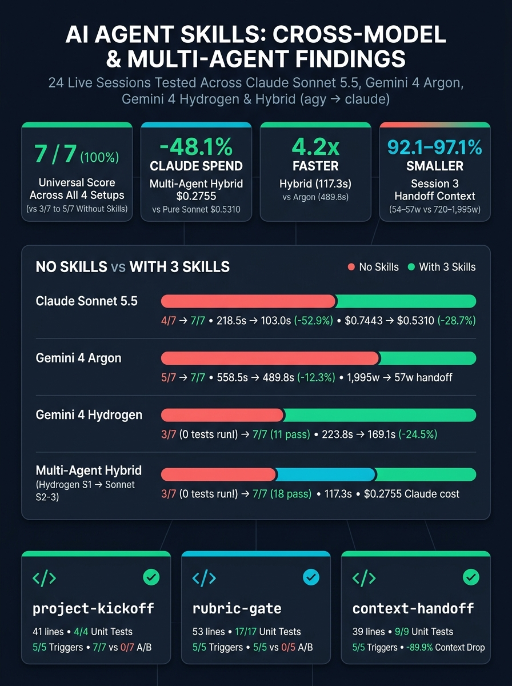

# context-handoff

**Stop context rot, avoid cold-cache token spikes, and run autonomous fresh-session `claude -p` coding batches.**

Long AI chats degrade well before hitting hard token limits ("context rot")—repeating failed debugging loops and triggering expensive cold-cache rewrites when chats resume after a break. `context-handoff` solves this across **both** sides of a hybrid **Antigravity (`agy`) + Claude Code (`claude`)** setup using zero-dependency Python 3 stdlib scripts and deterministic hooks.

---

## Why Use `context-handoff`? (Empirical Benchmark Results)

* **Trigger Precision (`U2`):** `5 / 5` (`3/3` positive prompts triggered; `0/2` false positives on small coding edits).
* **Live 2-Session Autonomous Runner (`haiku`):** Built and unit-tested a real 2-file SQLite `inbox.py` app across **2 isolated fresh `claude -p` sessions** linked solely by `HANDOFF.md` + `tasks.json`—finishing `2 / 2` tasks for **`$0.0106` total** (`7.28s` + `10.75s`).
* **A/B Handoff Context Reduction (`U1`):** Cut carried resume context by **`89.9%`** (`~2,445` → `~247` estimated tokens) while keeping `Dead Ends` explicit so fresh sessions never repeat failed approaches.
* **Cross-Model 3-Session Impact (`24` Live Sessions):** Across `Claude Sonnet 5.5`, `Gemini 4 Argon`, `Gemini 4 Hydrogen`, and `Multi-Agent Hybrid`, rotating via `<400`-word `HANDOFF.md` shrank Session 3 carryover context by **`92.1%–97.1%`** (`54–57` words vs. `720–1,995` words). On Claude Sonnet alone, Session 3 finished **`6x` faster (`18.2s` vs. `110.2s`)** and **`63.3%` cheaper (`$0.1358` vs. `$0.3700`)**.



Raw benchmark logs: [`tests/live_eval_results.json`](./tests/live_eval_results.json) · [`docs/benchmarks/sonnet_3session_results.json`](./docs/benchmarks/sonnet_3session_results.json) · [`docs/benchmarks/cross_model_matrix_results.json`](./docs/benchmarks/cross_model_matrix_results.json)

---

## Quick Start & Installation

### Antigravity (`agy`) & Claude Code (`claude`)
* **Antigravity:** Register in `~/.gemini/config/skills.json` or place under `.agents/skills/context-handoff/`.
* **Claude Code:** Symlink into `~/.claude/skills/context-handoff`:
  ```bash
  ln -s /path/to/context-handoff ~/.claude/skills/context-handoff
  ```

### Optional Zero-Token Watcher Hooks
See [hooks/hooks.json.example](./hooks/hooks.json.example):
* **Antigravity `PreInvocation` ([hooks/smart_zone_watcher.py](./hooks/smart_zone_watcher.py)):** Checks turn count (`>=16`), transcript size (`>=55 KB`), and **error-loop content rot** (`>=3` `ERROR` entries in the last `6` steps) at `$0` API cost, showing a once-per-cooldown rotation banner.
* **Claude Code `PreCompact` ([hooks/claude_precompact_snapshot.py](./hooks/claude_precompact_snapshot.py)):** Saves recent user prompts and edited file paths to `.handoffs/precompact_backup.md` before compaction drops details.

---

## Core Tools

1. **Interactive `<400`-Word Handoff Builder** ([scripts/build_handoff.py](./scripts/build_handoff.py)) — Archives any prior `HANDOFF.md` into `.handoffs/archive/`, enforces the 5-section schema (`Goal`, `Verified Done`, `Dead Ends`, `Active Files`, `Next Exact Action`), attaches `git status`, and copies a 3-line boot prompt to your macOS clipboard (`pbcopy`).
   ```bash
   python3 scripts/build_handoff.py --project-dir . --goal "..." --done "..." --dead-ends "..." --next-action "..." --copy-prompt
   ```
2. **Autonomous Fresh-Session Runner** ([scripts/loop_runner.py](./scripts/loop_runner.py)) — Executes `tasks.json` batches (`1–3` tasks per fresh `claude -p` session), runs deterministic `verify_cmd` checks, logs token/cost telemetry to `.handoffs/loop_log.json`, and trips a **circuit breaker** after `max_failures` consecutive failures.
   ```bash
   python3 scripts/loop_runner.py --project-dir . --tasks tasks.json --batch-size 1 --max-iterations 5 --max-failures 2
   ```

---

## Verification (Runs Locally in <0.1s, `$0` Cost)

```bash
python3 -m unittest discover -s tests -v
python3 -m compileall -q scripts hooks tests
```
All `9 / 9` unit tests pass using Python 3 standard library only.
